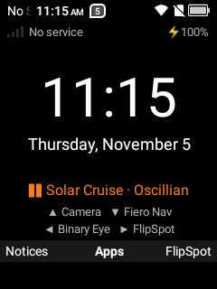
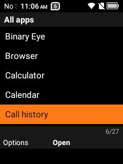
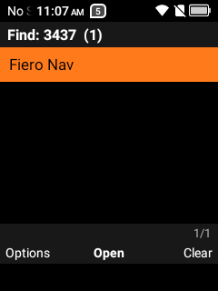
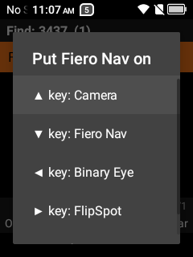

# Fiero Launcher

A minimal home screen for **keypad Android flip phones**, built on and for the TCL Flip 2. Everything works
from the keypad: there's no touch screen to rely on, so nothing needs one.

<p>
  
  
  
  
</p>

## What it does

- **Home screen:** big clock and date, signal / carrier / battery, ringer mode, and a **Now Playing** line
  for whatever music app is playing (Spotify, podcasts…).
- **D-pad shortcuts:** Up, Down, Left, Right and the right soft key each open an app you choose.
- **All apps:** an alphabetical list. Type on the number keys to filter it T9-style: `6277` finds "Maps",
  `3437` finds "Fiero Nav". Matching works on the start of any word in the name.
- **Phone-style keys:** Call opens the dialer; digits, `*` and `#` open the dialer with that key typed.
- **Notices:** the left soft key opens a keypad list of your notifications (the stock shade is built for
  touch and, on a 240×320 screen, mostly shows the music player). OK opens one, left soft key clears it,
  right soft key clears all. The home screen shows how many are waiting ("Notices 2").
- **Long presses:** `*` play/pause, `#` toggles Silent.
- **Front button** (TCL Flip 2): pauses music, even with the flip closed. It never starts playback, so a
  pocket press can't set it off; hold `*` on the home screen to play.
- **Outer screen** (TCL Flip 2): a Now Playing strip (song and artist) along the bottom of the small
  128×128 front screen, under the phone's own clock. Optional: make that screen's background black.
- **Tiny:** ~75 KB, no libraries, no network access, no ads or tracking.

## Keys on the home screen

| Key | Action |
|---|---|
| D-pad ▲ ▼ ◀ ▶ | Open the app on that key |
| OK | All apps |
| Left soft key | Notices (your notifications) |
| Right soft key | Open the app on that key (shown on the label) |
| Call | Dialer |
| 0–9, `*`, `#` (short) | Dialer with that key typed |
| `*` (hold) | Play / pause what's playing |
| `#` (hold) | Ringer: Normal ↔ Silent |

**All apps:** ▲▼ move, ◀▶ page, OK opens, digits filter, Back deletes a digit (then leaves),
right soft key clears the filter, **left soft key = Options**: put the app on a key, or App info.

**Notices:** ▲▼ move, OK opens, left soft key clears, right soft key clears all (press twice), Back goes home.
Media players are left out (they're on the Now Playing line); ongoing ones (USB, charging) are grey.

To change a shortcut: OK → find the app → left soft key → pick the key.

## Install

You need a computer with [adb](https://developer.android.com/tools/releases/platform-tools) and USB debugging
turned on in the phone's Developer options.

1. Download `fiero-launcher-*.apk` from [Releases](../../releases) (or [build it](#build)).
2. Install it:
   ```bash
   adb install -r fiero-launcher-0.4.0.apk
   ```
3. Let it read notifications (for Notices) and what's playing (Now Playing, `*` play/pause, the front button), and
   draw on the outer screen (optional, TCL Flip 2):
   ```bash
   adb shell cmd notification allow_listener dev.mike.fierolauncher/dev.mike.fierolauncher.MediaListener
   adb shell appops set dev.mike.fierolauncher SYSTEM_ALERT_WINDOW allow
   ```
4. Try it without changing anything: `adb shell am start -n dev.mike.fierolauncher/.HomeActivity`
5. **Make it the home screen** when you're happy:
   ```bash
   adb shell am start -n dev.mike.fierolauncher/.HomeActivity --ez home_alias true
   adb shell cmd package set-home-activity dev.mike.fierolauncher/.HomeAlias
   ```

**To undo**, point the phone back at its original launcher. On the TCL Flip 2 that's Launcher4:

```bash
adb shell cmd package set-home-activity com.tim.flip2.launcher4/com.android.launcher3.Launcher
```

### Black outer screen (optional, TCL Flip 2)

The outer screen's clock sits on the phone's wallpaper. Fiero can set a plain black wallpaper (the lock
screen turns black too; Fiero's home screen is black anyway) and keep the old one to put back:

```bash
adb shell pm grant dev.mike.fierolauncher android.permission.READ_EXTERNAL_STORAGE   # lets it back up the old one
adb shell am start -n dev.mike.fierolauncher/.HomeActivity --es wallpaper black
adb shell am start -n dev.mike.fierolauncher/.HomeActivity --es wallpaper restore    # undo
```

(For another phone, find the original with
`adb shell cmd package query-activities -a android.intent.action.MAIN -c android.intent.category.HOME`.)

Fiero never offers itself as a home app until step 5: its home-screen entry ships switched off. Keep your
original launcher installed as a fallback.

## Compatibility

- Android 11 (API 30) or newer. Built and tested on the **TCL Flip 2** (4058G, 240×320, no touch screen).
- Other keypad Android phones should work if their keys send standard Android keycodes. The table in
  [`ui/KeyRouter.kt`](app/src/main/java/dev/mike/fierolauncher/ui/KeyRouter.kt) lists what the Flip 2 sends;
  `adb logcat -s Fiero` shows each key press on a debug build.
- On first start the shortcuts are the author's (Spotify, Maps Go, F-Droid, FlipSpot). Any whose app isn't
  installed shows as empty until you assign it.

## Build

Requirements: JDK 17+ and the Android SDK (Android Studio provides both).

```bash
./gradlew assembleRelease     # app/build/outputs/apk/release/app-release.apk (R8-shrunk)
./gradlew testDebugUnitTest   # T9 matching tests
```

Put `sdk.dir=…` in `local.properties` if Gradle can't find the SDK. The release build is signed with your
**debug key** for convenience; use your own keystore if you distribute it.

On Windows, `scripts\deploy.ps1` does build + install + launch + logcat in one go (`-Release`, `-SetHome`,
`-RevertHome`, `-HomeInfo`; see the top of the script).

## How it works

Plain Kotlin and Android Views, no dependencies. The Now Playing line reads active media sessions through
a notification listener, which is also what allows Silent mode. On the TCL Flip 2 the front button arrives
as the broadcast `com.tct.intent.action.QUICK_BUTTON_TAP`, and the outer screen is a second display
(128×128) that Fiero draws on with an overlay window. The home-screen entry lives on a disabled
activity-alias so installing Fiero can't hijack the Home key.
[`PLAN.md`](PLAN.md) has the design notes and everything learned about the phone along the way.

## Related

- [Fiero Nav](https://github.com/SuperFieroStatus/fiero-nav): keypad-first turn-by-turn driving navigation.
- [FlipSpot](https://github.com/SuperFieroStatus/flipspot): a keypad Spotify front end.

## License

[MIT](LICENSE)
